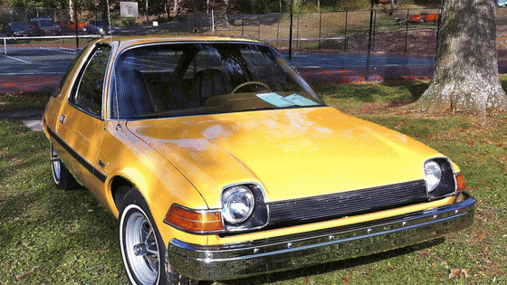
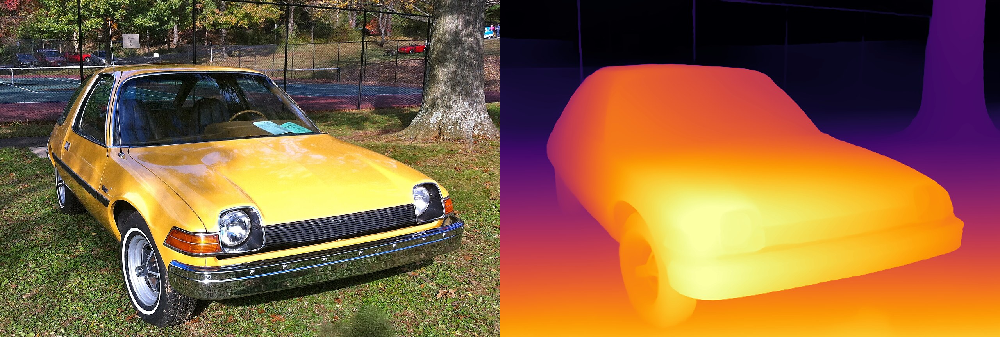
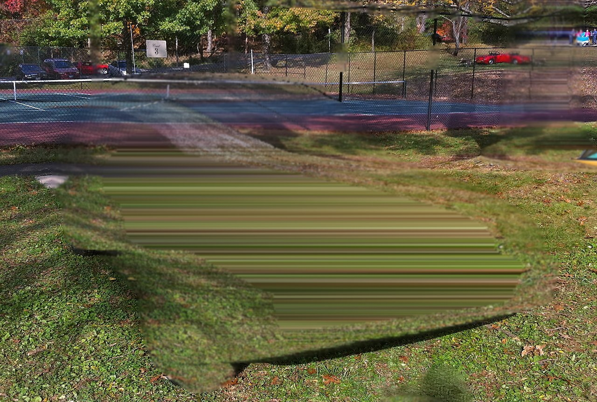
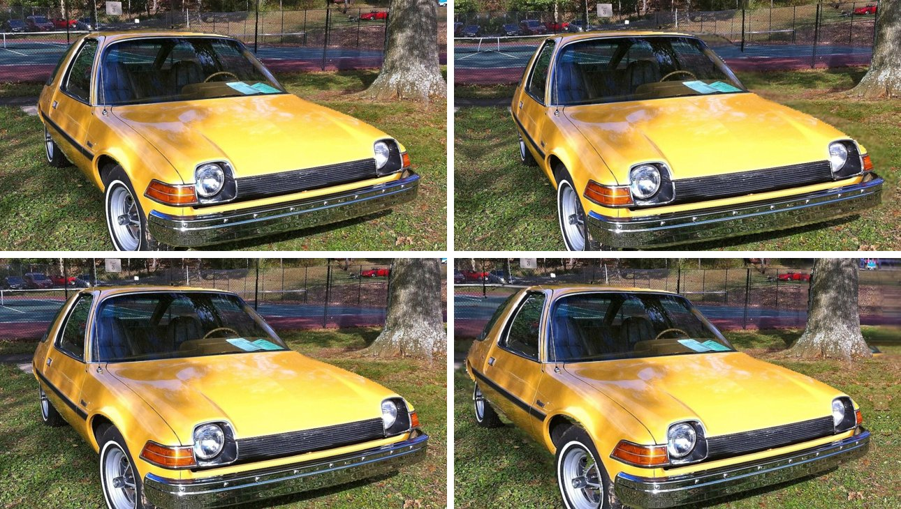
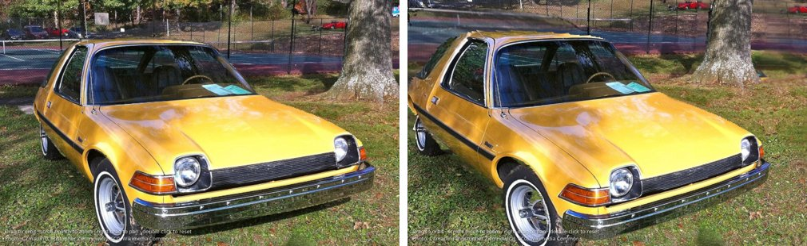

# photo-to-3d-grokbot



*One photo of a 1975 AMC Pacer turned into a 3D scene on a CPU in about 85 seconds. Photo: CZmarlin (Christopher Ziemnowicz), [CC0](https://creativecommons.org/publicdomain/zero/1.0/), via [Wikimedia Commons](https://commons.wikimedia.org/wiki/File:1975_AMC_Pacer_base_model_at_2012_Rockville_e.jpg).*

One command turns one photo of a car (or a street, a room, a product) into:

- a depth map (`depth.png`)
- a textured 3D mesh (`scene.glb`, opens in Blender, three.js, Windows 3D Viewer, model-viewer)
- a single-file interactive viewer (`viewer.html`, drag to orbit, no server, no CDN)
- a seamless orbit video (`orbit.mp4`, 1280x720, 30 fps) and a looping GIF (`orbit.gif`, under 10 MB so it plays on GitHub and posts to X)

It runs on CPU. No GPU, no API key, no paid service. It was built and tested by Grok Bot on its own Linux box; the prompts, including the fixes the first render needed, are in [PROMPTS.md](PROMPTS.md).

## Quick start

Tested end to end from a fresh clone in a fresh venv on Linux (Python 3.13, 8 CPU cores, no GPU, Google Chrome installed):

```bash
git clone https://github.com/swiftverse/photo-to-3d-grokbot.git
cd photo-to-3d-grokbot
python3 -m venv .venv && . .venv/bin/activate
pip install -r requirements.txt
python make_3d.py examples/car.jpg
```

Outputs land in `out/car/`. Open `out/car/viewer.html` in any browser.

If you do not have Chrome or Chromium installed, run `python -m playwright install chromium` once; the script falls back to Playwright's browser. Set `CHROME_PATH` to point at a specific browser. Use `--no-video` to skip rendering and only produce the depth map, mesh and viewer.

Your own photo:

```bash
python make_3d.py my_car.jpg --credit "Photo: me"
```

Check a viewer headless (loads it, drags it, fails on any console error):

```bash
python tools/check_viewer.py out/car/viewer.html out/car/viewer_check
```

## Pipeline

```
 car.jpg (1280x863)
     |
     v
 [1] Depth Anything V2 Small (24.8M params, CPU)  -> relative inverse depth, 1280x863
     |
     v
 [2] back-project 512x345 grid, pinhole camera, 60 deg HFOV, depth mapped to 1..9
     |  - median filter, then drop triangles whose depth ratio > 1.05 (object edges)
     |  - fill layer: wide min-filter pushes the car back to the scene behind it,
     |    car pixels filled by mirroring the background row by row,
     |    layer extended 20% past the photo edges, placed 3% further back
     v
 scene.glb  (front 174,602 verts / 341,944 faces + fill 98,092 / 194,922)
     |
     +--> [3] viewer.html  (three.js r187 + GLTFLoader + OrbitControls, all inline)
     |
     +--> [4] headless Chrome (SwiftShader) renders 150 frames -> orbit.mp4 -> orbit.gif
```

| Photo and depth | Fill layer (car removed by mirroring the background) |
| --- | --- |
|  |  |

Four frames of the loop (0%, 25%, 50%, 75%):



## Real numbers from the tested run

| Step | Time | Notes |
| --- | --- | --- |
| `pip install -r requirements.txt` | 36 s | fresh venv, pip download cache already warm; a cold install also downloads the CPU torch wheel |
| Depth, first run | 12.0 s | includes downloading the ~95 MB model from Hugging Face |
| Depth, cached model | 4.1 to 4.8 s | 8 CPU threads |
| Mesh, fill layer, .glb | 0.6 to 0.8 s | 512x345 grid, 2.74% of triangles trimmed, 46.8% of the grid marked as occluder (mostly the car) |
| Viewer HTML | 0.04 s | |
| Video, 150 frames | 74 to 79 s | software WebGL; a real GPU makes this a few seconds |
| **Total, one command** | **87 s cold, 83 to 84 s warm** | |

| File | Size |
| --- | --- |
| `scene.glb` | 12.8 MB (272,694 vertices, 536,866 triangles, two JPEG textures) |
| `viewer.html` | 17.9 MB (the .glb plus three.js, base64 inline) |
| `orbit.mp4` | 6.2 MB (1280x720, 30 fps, 5 s, H.264) |
| `orbit.gif` | 9.6 MB (560x315, 75 frames) |
| `depth.png` | 0.17 MB |

The output is deterministic: the fresh-clone run produced frames identical to the development run.

Cost: $0. Everything runs locally.

## Useful flags

| Flag | Default | What it does |
| --- | --- | --- |
| `--grid` | 512 | mesh resolution (vertices across); 768 gives smoother silhouettes but a 25 MB .glb |
| `--far` | 9.0 | far/near ratio; higher means more dramatic depth |
| `--fov` | 60 | assumed horizontal field of view of the photo; use ~70 for phone wide shots |
| `--edge-ratio` | 1.05 | lower trims more edge triangles (cleaner edges, more holes) |
| `--yaw` | 6 | orbit swing in degrees in the video |
| `--pivot` | 0.95 | orbit pivot as a fraction of the median depth; ~0.95 keeps a close subject like a car centred |
| `--margin` | 0.97 | how much of the photo the camera frames |
| `--dolly` | 0.04 | push-in during the loop, fraction of the pivot distance |
| `--hole-width` | 0.8 | horizontal reach of the fill min-filter; must be wider than the subject |
| `--pad` | 0.2 | how far the fill layer extends past the photo edges |
| `--no-fill` | off | skip the background layer |
| `--frames`, `--fps`, `--video-size`, `--gif-width` | 150, 30, 1280x720, 560 | video settings |

## Interactive viewer

`viewer.html` opens straight from disk. Drag to orbit, scroll or pinch to zoom, right-drag to pan, double-click to reset. The orbit is clamped to 10 degrees sideways and 8 degrees up or down, because this is a 2.5D scene: swing further and you see the back of the world.



## What the first render got wrong

The defaults above are not the first attempt. The first run, with settings tuned for a landscape photo, had three visible problems, all fixed in code:

1. **Cropped and wobbly.** The orbit pivoted on a point in front of the car and the frame cut the bumper. Fix: pivot at 0.95 of the median depth, frame 97% of the photo, push in 4% instead of 8%.
2. **An olive smear beside the hood.** The background layer used a square 27-cell min-filter, far smaller than the car, so the car kept its own depth in that layer and the inpainted strip at its edge became a stretched sheet. Fix: a wide, short filter (80% of the image width by 9 rows) and a row-by-row mirror fill instead of OpenCV Telea inpainting, so the strip revealed beside the car shows grass texture.
3. **A grey strip at the frame edge** at the end of the swing. Fix: the fill layer extends 20% past the photo with mirrored texture, and the viewer limit dropped from 14 to 10 degrees.

## Limitations

- **This is 2.5D, not a scan.** One photo has one viewpoint. The model guesses depth for what it can see; the far side of the car, its roof and the ground under it do not exist. Small camera moves look convincing, large ones do not.
- **Depth is relative.** Depth Anything V2 Small outputs affine-invariant inverse depth, so the 1..9 range is a choice, not a measurement. Do not measure the car on this mesh.
- **The revealed strip is a guess.** Mirroring the background works for grass, gravel and asphalt. It produces visible copies on strongly patterned backgrounds, and it is softer than the real photo.
- **Edges are a trade-off.** Trimming at depth jumps leaves slightly stepped silhouettes at grid resolution (visible on the hood line); not trimming gives stretched rubber sheets.
- **Glass, chrome and thin things** (windows, the bumper, the chain-link fence, the antenna) often get wrong or blended depth; you can see the windscreen behave like a painted surface.
- **The video step is slow on CPU** because Chrome uses software WebGL. The interactive viewer is fast on any laptop.

## How to expand

- **Full 360 car model from one photo:** image-to-3D models (TRELLIS.2, Hunyuan3D, Tripo, Meshy) generate a complete object mesh, including an invented back side, for well under a dollar per model on their APIs.
- **More photos, real geometry:** walk around the car taking 30 to 200 overlapping photos and run photogrammetry (COLMAP, Meshroom, RealityScan) for a true mesh.
- **Phone video, photoreal:** train a Gaussian splat (Scaniverse, Polycam, Postshot, nerfstudio, Brush) from a slow loop around the car and view it in the browser.
- **Better fill:** swap the mirror fill for LaMa or a diffusion inpainting model.
- **Cinematic shots:** import `scene.glb` into Blender, add lights and a camera path, render in Cycles or EEVEE.
- **On a website or listing page:** host `scene.glb` and show it with `<model-viewer>` or the three.js viewer here.

## Credits and licences

- Code: MIT, see [LICENSE](LICENSE).
- Photo `examples/car.jpg`: "1975 AMC Pacer base model at 2012 Rockville e" by CZmarlin (Christopher Ziemnowicz), CC0 1.0 public domain dedication, [Wikimedia Commons](https://commons.wikimedia.org/wiki/File:1975_AMC_Pacer_base_model_at_2012_Rockville_e.jpg). Downloaded at 1280 px wide (original 2269x1530). No credit is legally required; the author asks for one, so it is given here.
- Depth model: [Depth Anything V2 Small](https://huggingface.co/depth-anything/Depth-Anything-V2-Small-hf), Apache-2.0, downloaded at run time.
- [three.js](https://github.com/mrdoob/three.js) r187, MIT, bundled as `web/three-bundle.min.js` (rebuild with `web/build_bundle.sh`).
